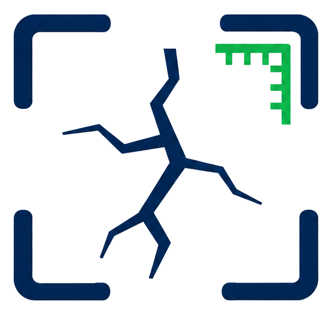
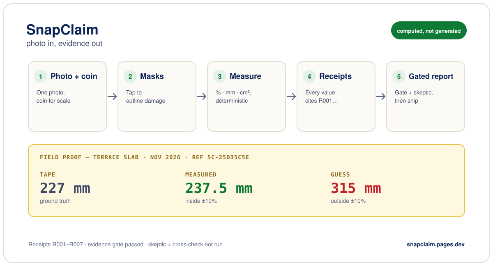
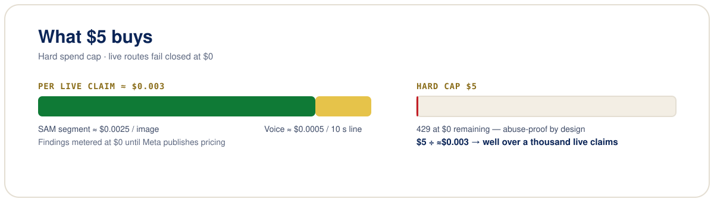
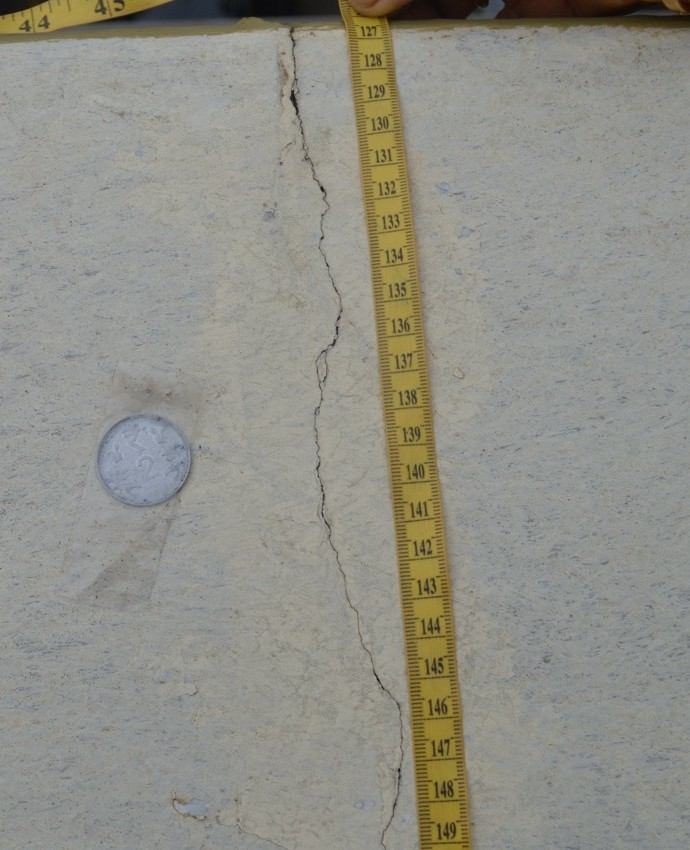
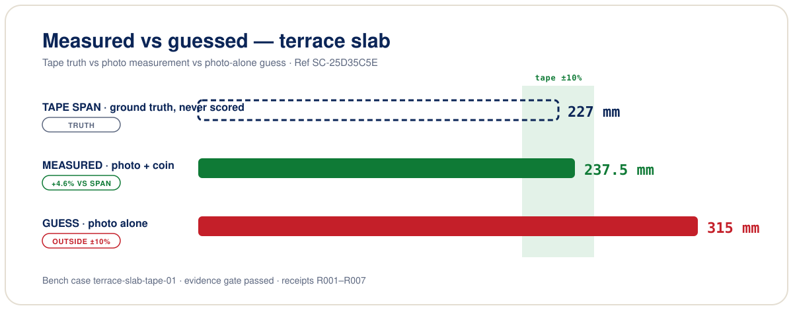

<picture>
  <source media="(prefers-color-scheme: dark)" srcset="assets/snapclaim-mark-dark.png">
  
</picture>

# SnapClaim

> Point your phone at damage, speak one line about it - get a claim-ready report where every shipped number cites a machine-checkable receipt. **Computed, not generated.**

**[Try the live app](https://snapclaim.pages.dev) · [Marketing site](https://landing.snapclaim.pages.dev) · [Demo video](https://youtu.be/CdqSvKHyrCg) · [Gallery](https://snapclaim-gallery.parithosh.workers.dev) · [Case study (PDF)](https://snapclaim.pages.dev/reports/Case%20Study%20Comparative%20Measurement%20of%20a%20Terrace-Slab%20Crack.pdf)**

**Built on Meta AI, a 4-model pipeline:** SAM 3.1 (damage masks) + Muse Spark 1.3 (evidence-gated findings) + **Muse Spark Open**, open weights served by Baseten (independent skeptic) + Muse Voice Transcribe (spoken intake). **Open-weights fine-tuning:** our crack-tuned SlimSAM-77 mask decoder is on the Hugging Face Hub as [`tariqkhalif/slimsam-77-crack`](https://huggingface.co/tariqkhalif/slimsam-77-crack) (held-out crack mIoU 0.174 stock vs 0.697 tuned, [`training/slimsam-crack/`](./training/slimsam-crack/)), and [`finetune/`](./finetune/) holds a LoRA (PEFT) recipe for Muse Glimmer and Muse Spark Open (smoke-tested, no trained weights yet).

[](https://github.com/Parithosh-Varma/snapclaim/actions/workflows/ci.yml)
[](./tests)
[](./package.json)
[](./LICENSE)

## Why it exists

Damage claims run on vibes: a photo, a guess ("looks like ~30 cm"), and whoever argues hardest wins. VLMs make this worse — they guess measurements fluently and confidently.

SnapClaim inverts the burden of proof. The numbers come from deterministic code over segmentation masks, never from a model's imagination. Models only write sentences, and a server-side evidence gate rejects any sentence whose numbers don't trace back to a receipt. The result is a report a skeptic — human or model — can re-derive from scratch.

Three principles run through all of it:

1. **No LLM touches the numbers.** Models write sentences; arithmetic is code.
2. **Fail closed.** No key → 503. No evidence → 422. Empty model output → error. The backend never invents a mask, a transcript, or a number.
3. **Everything replays.** `npm run replay` recomputes a report from request + receipts and prints MATCH or DRIFT.

## Proven on a real crack

One terrace-slab crack, ref `SC-D8ECE64B` — "crack on the pavement slab of the terrace". Photo-pixel outlines scaled by coin diameter, tilt-corrected from the ellipse:

- Crack length **232 mm [R005]** (Confirmed) · width **3.2 mm [R006]** (Unverified — no width ground truth) · surface **0.73% [R002]** (Confirmed) · area **7.48 cm² [R004]** (Confirmed) · severity **significant [R007]** (Confirmed)
- Verification: evidence gate passed / skeptic verified / mask cross-check verified.
- Manual refs: straight tape 227 mm (225–230, context only — a path must exceed its chord); thread 238.8 mm (different horizontal crack, NOT comparable); pin-to-pin 274 mm.
- Live PDFs: [report](https://snapclaim.pages.dev/reports/snapclaim-SC-D8ECE64B.pdf) · [case study](https://snapclaim.pages.dev/reports/Case%20Study%20Comparative%20Measurement%20of%20a%20Terrace-Slab%20Crack.pdf)

Honest headline: n = 1, and a span is context, not a scored length. Treat "measured" as receipt-backed, not tape-proven, until the 10–20 tape set lands. An earlier run on a different photo measured 237.5 mm with a user-supplied 25 mm coin (see [Evaluation](#evaluation)) — separate run, separate inputs, never averaged with this one.

## What is measured today

All three commands are free and deterministic; run them yourself.

| Check | Command | Result on `main` |
|---|---|---|
| Measurement code vs known answers (54 scenes drawn in code, coin scale, some on tilted walls) | `npm run bench:truth` | length median error 1.4%, 100% within ±10%; width median error 4.0%, 96.3% within ±10%; 3/3 no-scale refusals held |
| Regression on dev mask fixtures, plus known-answer error on the 5 synthetic ones | `npm run eval` | 10 pass, 0 skip, 0 fail; 5 scored, median abs error 1.0 mm, 5/5 within ±10% (drawn cracks, not real photos) |
| Live pipeline on held-out real photos | `npm run bench` | 4 public photos run live 2026-11-02: 4/4 refused millimetres, but only 2/4 masks were on the crack and the skeptic flagged neither miss ([details](docs/eval-report.md#failures-and-misses)); 7 team cases UNRUN, so the command still exits 1 on purpose |

What this does not show yet: how well SAM finds the crack on a real photo. `bench:truth` checks the maths given a mask, not the mask itself. One real crack has a tape span (`terrace-slab-tape-01`, n = 1, above), but a span is context, not a scored length, so `npm run bench:gap` still prints UNSCORED. We would rather show that gap than fill it with a number we cannot back.

**Global by design:** the measurement engine assumes no currency, country, or language — a scale reference is any known-size object (coin, ruler, bank card), and the transcript is free text in any language. Voice is auto-detected by default; callers can still send an optional `languageBias`.

**Who it is for:** tenants and landlords settling security-deposit disputes at move-out, and households filing a home insurance claim. Both sides look at the same crack and argue about how big it is; SnapClaim gives them one measured, replayable record instead of two memories. It documents, it does not advise.

## Demo video

Watch the full loop — photo + coin, tap to mask, gated findings, skeptic, SVG annexure:

<https://youtu.be/CdqSvKHyrCg>

> _More walkthroughs coming — this section will grow with new cuts._

## Project gallery

Photo gallery of captures, pipeline diagrams, and the terrace-slab field proof: <https://snapclaim-gallery.parithosh.workers.dev> (source: [`gallery/`](./gallery/) — `gallery.snapclaim.pages.dev` custom domain pending).

## Contents

- [Why it exists](#why-it-exists)
- [Proven on a real crack](#proven-on-a-real-crack)
- [What is measured today](#what-is-measured-today)
- [Demo video](#demo-video)
- [Project gallery](#project-gallery)
- [Meta AI stack](#meta-ai-stack)
- [Quickstart](#quickstart)
- [How it works](#how-it-works)
- [Headless API (no UI)](#headless-api-no-ui)
- [Modes: demo vs live](#modes-demo-vs-live)
- [API reference](#api-reference)
- [Configuration](#configuration)
- [Deploying](#deploying)
- [Cost and limits](#cost-and-limits)
- [Privacy and security](#privacy-and-security)
- [Evaluation](#evaluation)
- [Project structure](#project-structure)
- [Development](#development)
- [Scope and boundaries](#scope-and-boundaries)
- [Provenance and license](#provenance-and-license)

Built on the [Meta AI developer platform](https://dev.meta.ai), with four Meta model families, each doing one job:

| Model | Job in SnapClaim | Served by |
|---|---|---|
| **SAM 3.1** | Segments the damage and the coin from a tap (point prompts) | Meta AI API (`api.meta.ai`) |
| **Muse Spark 1.3** | Drafts the findings; the evidence gate ships a sentence only if every number cites a receipt | Meta AI API |
| **Muse Spark Open** (open weights) | Independent skeptic that re-checks the findings | **Baseten**, official inference partner (`inference.baseten.co`) |
| **Muse Voice Transcribe** | Turns the one spoken line into text, any language | Meta AI API (file + realtime) |

On the phone, a SlimSAM model gives an offline mask preview before anything is sent. We fine-tuned its open-weights mask decoder on public crack masks (CC BY 4.0) and published it as [`tariqkhalif/slimsam-77-crack`](https://huggingface.co/tariqkhalif/slimsam-77-crack) on the Hugging Face Hub: held-out crack mIoU 0.174 stock vs 0.697 tuned in the browser build (training code and eval in [`training/slimsam-crack/`](./training/slimsam-crack/)). Endpoints and model IDs: [Meta models used](#meta-models-used).

## Quickstart

Requirements: Node.js ≥ 22.18. No keys needed - the default mode runs fully offline at $0.

```bash
npm install
npm test            # full suite, live paths with fetch stubbed, zero API spend
npm run typecheck
npm run backend:start   # http://127.0.0.1:8787
```

Or run everything in Docker (mock mode, no keys):

```bash
docker compose up --build
# app:     http://localhost:8080   (Settings -> Backend: http://localhost:8787)
# backend: http://localhost:8787/v1/health
```

For live calls, put `MOCK_MODE=0` and your keys in `.env`; compose passes it to the backend at run time and nothing is baked into the image.

Then run `npm --prefix react run dev` (http://localhost:5173) and press **Use sample measurement** - the full loop runs in one tap: measure → gated findings → skeptic → SVG annexure. No photo needed.

```bash
npm run eval        # deterministic measurement bench
npm run replay -- request.json measurement.json   # recompute a report: MATCH or DRIFT
npm run backend:smoke   # end-to-end smoke against a running backend
```

## How it works



```
photo (+ coin for scale)  +  one spoken line
   ↓
MASKS - tap damage + coin: on-device SlimSAM preview, or live SAM 3.1
   point prompts; every mask becomes pixel statistics (area, skeleton,
   region count) with no model in the loop
   ↓
MATH - deterministic measurement engine
   % damaged · crack length (mm) · mean crack width (mm) · area (cm²)
   no scale reference → percentages only, clearly labeled, never upgraded
   ↓
RECEIPTS - every value carries its formula, inputs, confidence and id
   (R001…), serializable for replay
   ↓
FINDINGS - Muse Spark drafts sentences; the evidence gate ships them only if
   every number cites its receipt (else HTTP 422 with named failures)
   ↓
SKEPTIC - Muse Spark Open re-checks the findings; unreproducible ones are
   printed DISPUTED, never hidden
   ↓
ANNEXURE - code-drawn SVG: mask outlines, findings, receipts table
```

Three principles run through all of it:

1. **No LLM touches the numbers.** Models write sentences; arithmetic is code.
2. **Fail closed.** No key → 503. No evidence → 422. Empty model output → error. The backend never invents a mask, a transcript, or a number.
3. **Everything replays.** `npm run replay` recomputes a report from request + receipts and prints MATCH or DRIFT.

## Headless API (no UI)

The app is a client of the API, not the API. `POST /v1/claim` runs the whole
pipeline once - segmentation → pixel statistics → calibrated measurement →
gated findings → SVG annexure - and returns the evidence package plus the inputs
to replay it:

```bash
npm run backend:start
npm run cli -- claim --image damage.jpg --tap 420,310,crack \
  --coin 900,700,24.26 --say "crack above the window" \
  --out report.json --svg annexure.svg
```

Masks already computed? Post COCO RLE instead and skip every model call (and
every key) - deterministic, $0, works even in mock mode:

```bash
curl -s -X POST http://127.0.0.1:8787/v1/claim \
  -H 'content-type: application/json' \
  -d '{"masks":[{"id":"damage-1","label":"crack","confidence":0.9,
       "rle":{"size":[10,10],"counts":[0,5,95]}}],"transcript":"crack on the wall panel"}'
```

Full contract, all routes, the CLI flags and a Node client:
**[`docs/API.md`](./docs/API.md)**. Low-level routes stay available when you
want an intermediate result - nothing in the app bypasses them.

## Modes: demo vs live

> What is real vs mocked: **Measurement (`/v1/measure`, `/v1/observe`, receipts, gate) is keyless and deterministic — runs offline, $0. Live findings / skeptic / SAM / voice use our keys with a spend cap (`SPEND_GUARD_USD`, default $5). Photos stay on the phone except two explicit taps: Cross-check sends the photo once to SAM 3.1 via the backend, and Render attaches it to the annexure.** Demo defaults to mock ($0, no keys).

| | Demo (default) | Live (`MOCK_MODE=0` + keys) |
|---|---|---|
| Masks | Supplied fixture (`backend invents no masks`) | SAM 3.1 point prompts via `/v1/segment`; the app falls back to on-device SlimSAM on any failure |
| Findings / skeptic | Deterministic mocks ($0) | Muse Spark 1.3 / Muse Spark Open on Baseten |
| Voice | Supplied `fixtureTranscript` | Muse Voice Transcribe proxy (`/v1/transcribe`) |
| Measure, observe, gate, render, replay | Real in both modes | Real in both modes |

The health badge reports the mode: `GET /v1/health` → `{mode: "mock" | "live" | "config-error"}`.

For local development, Settings → Developer → **Open admin panel** flips the running backend between mock and live without a restart. It calls `POST /v1/admin/mode` with `Authorization: Bearer $ADMIN_TOKEN`; the token is kept in `sessionStorage` only. The override lives in memory, so a restart or redeploy returns to the `MOCK_MODE` env default. Leave `ADMIN_TOKEN` unset on the public Worker - admin writes then return 403.

### Meta models used

| Role | Model | Where |
|---|---|---|
| Perception - damage masks | **SAM 3.1** (point/box/negative prompts + multi-object `objects[]`, one billed image) | `https://api.meta.ai/v1` |
| Reasoning - evidence-gated findings | **Muse Spark 1.3** (multimodal: receipts + optional damage photo `image_url`, `response_format: json_object`) | `https://api.meta.ai/v1/chat/completions` |
| Damage description (vision) | **Muse Spark 1.3** (`/v1/describe`: photo + reporter note → prose) | `https://api.meta.ai/v1/chat/completions` |
| Independent skeptic (open weights) | **Muse Spark Open** | `https://inference.baseten.co/v1` · `meta-models/muse-spark-open-1026` |
| On-device damage masks (offline / fallback) | **SlimSAM-77** (compressed SAM) + our crack-tuned decoder [`tariqkhalif/slimsam-77-crack`](https://huggingface.co/tariqkhalif/slimsam-77-crack) | in the browser, transformers.js · [`training/slimsam-crack/`](./training/slimsam-crack/) |
| Voice intake (any language; auto-detected, optional `languageBias`) | **Muse Voice Transcribe** | `POST https://api.meta.ai/v1/asr/transcribe` (file) · `wss://api.meta.ai/v1/asr/realtime` (live) |

**Multi-model pipeline:** every claim combines four Meta model families - SAM 3.1 (live masks) + Muse Spark 1.3 (evidence-gated findings) + Muse Spark Open (independent skeptic, served by inference partner Baseten) + Muse Voice Transcribe (spoken intake). The app cross-checks the two mask sources against each other (`POST /v1/crosscheck`).

**Open-weights fine-tuning:** the on-device SlimSAM-77 mask decoder is fine-tuned for cracks (stock encoder frozen; decoder-only fine-tune, AdamW, 12 epochs on the public Özgenel Concrete Crack Segmentation Dataset (CC BY 4.0)) and published on the Hugging Face Hub as [`tariqkhalif/slimsam-77-crack`](https://huggingface.co/tariqkhalif/slimsam-77-crack): held-out crack mIoU 0.174 stock vs 0.697 tuned in the browser build. Training script, ONNX export, and evals live in [`training/slimsam-crack/`](./training/slimsam-crack/).

No image generation anywhere: every visual is drawn in code from the masks and the math. (Muse Image is unavailable in our region under Meta's Geographic Use Policy - the receipts pattern turns that constraint into a design principle, not a product boundary.)

## API reference

All replies are enveloped: `{ok: true, requestId, durationMs, result}`. Errors: `{ok: false, error, code, requestId, details?}` with HTTP 400 (bad input), 422 (gate or receipt mismatch), 429 (spend exhausted), 503 (key missing in live mode), 501 (unwired live path).

| Method & path | Input | Output |
|---|---|---|
| `GET /v1/health` | - | `{version, time, mode}` |
| `GET /v1/spend` | - | `{spentUsd, remainingUsd, limitUsd, entries}` |
| `POST /v1/claim` | masks (COCO RLE) **or** `imageUrl` + `damage[]` taps (+ optional `coin`), `transcript?`, `render?` | one-call pipeline: `{measurement, findings, gate, overlay, svg?, replay}` |
| `POST /v1/measure` | `{component, masks, scaleReference?, thresholds?}` · keyless | `{findings, receipts, mode: "absolute" \| "percent-only"}` |
| `POST /v1/observe` | `{masks: [{id, label, rle, confidence}], component?, reference?}` (COCO RLE) · keyless | `{component, masks, scaleReference}` - feeds `/v1/report` |
| `POST /v1/crosscheck` | `{a, b}` COCO RLE masks of one frame, `threshold?` (default 0.5) · keyless | `{intersection, union, iou, dice, verdict: AGREED/DISPUTED, threshold}` - SlimSAM-vs-SAM check |
| `POST /v1/report` | measure fields + `transcript?` (+ optional `drafts[]` to test the gate) | `{measurement, findings, gate}` |
| `POST /v1/segment` | demo: `{imageId, labels, fixture}` · live: `{imageUrl, width, height, points[1–16]}` | demo: `{component, masks}` · live: `{records: [{objectId, box, confidence, rle}]}` |
| `POST /v1/transcribe` | demo: `{fixtureTranscript}` · live: `{audioBase64, languageBias?, keywords?}` (mono WAV) | `{transcript, audioDurationMs, turns}` |
| `POST /v1/findings` | `{transcript?, findings, receipts}` (+ `component`/`masks` triggers a server-side recomputation cross-check) | `{findings, gate}` |
| `POST /v1/skeptic` | same as findings | `{findings, gate}` |
| `POST /v1/render` | report body (+ optional `overlay`) | `{svg, gate, findings}` |

**The evidence gate** (`src/findings/evidence-gate.ts`) enforces, per finding: at least one cited measured number; every number matches a cited receipt within rounding tolerance (normalizing shorthand IDs like `r1` → `R001`); `%` numbers match `percent` receipts, `mm` numbers match calibrated-length receipts, and `cm²` numbers match calibrated-area receipts; severity words match the cited severity receipt; all citations belong to one mask; ISO dates never count as evidence. Violations throw `EvidenceError` (HTTP 422), listing each failure.

**Measurement rules.** Reference confidence below `MIN_REFERENCE_CONFIDENCE` (default 0.6) drops the report to percent-only with a `scale_rejected` receipt. Default severity bands: cosmetic below 1% damaged, moderate up to 5%, significant above - escalated by crack length ≥ 150 mm or ≥ 3 disconnected regions. Thresholds are configurable per call and printed in the report.

## Configuration

Copy `.env.example` to `.env` (never commit it). Every variable is optional; unset means demo mode.

| Variable | Default | Effect |
|---|---|---|
| `MOCK_MODE` | unset (= demo) | Set `0` for live calls; live routes fail closed without keys |
| `META_API_KEY` | - | Muse Spark findings, SAM 3.1 segment, voice transcribe |
| `META_API_BASE` | `https://api.meta.ai/v1` | Override for proxies / debugging |
| `BASETEN_API_KEY` | - | Muse Spark Open skeptic |
| `BASETEN_API_BASE` | `https://inference.baseten.co/v1` | Override for proxies / debugging |
| `SPEND_GUARD_USD` | `5` | Hard cap on live spend; 429 at $0 remaining |
| `MIN_REFERENCE_CONFIDENCE` | `0.6` | Below this, reports stay percent-only |
| `PORT` | `8787` | Node server port |
| `ALLOWED_ORIGINS` | Pages + localhost (see below) | Exact-match browser allowlist; disallowed Origin → 403 `origin_not_allowed` before any cost. Requests without Origin (curl) are not blocked. |
| `REQUIRE_ORIGIN_FOR_EXPENSIVE` | unset (off) | Set `1` to also reject no-Origin on expensive routes (`/v1/claim`, `/v1/report`, `/v1/segment`, `/v1/transcribe`, `/v1/describe`, `/v1/findings`, `/v1/skeptic`, `/v1/render`) |

Default allowlist (when `ALLOWED_ORIGINS` is unset or empty): `https://snapclaim.pages.dev`, `http://localhost:8787`, `http://127.0.0.1:8787`, `http://localhost:5173`, `http://127.0.0.1:5173`. Entries are normalised (trim, lowercase scheme/host, no trailing slash); entries with paths or wildcards are ignored. Matching is exact only — no suffix/prefix matching.

## Deploying

**Backend** (one router, Node + Cloudflare Workers):

```bash
cd backend && npx wrangler deploy   # requires Cloudflare login; not run in CI
npx wrangler secret put META_API_KEY
npx wrangler secret put BASETEN_API_KEY   # when Baseten access is granted
```

**App** - `npm --prefix react run build`, serve `react/dist/` (Cloudflare Pages: build `npm run build`, output `dist/`). Point the Backend URL box at the Worker. Installable via `manifest.webmanifest`; the service worker caches the shell and never caches `/v1`.

**Pages site** (public app, gated admin):

> Live: <https://snapclaim.pages.dev> — open to anyone. Admin panel (`/admin`) is behind team login.

```bash
npm --prefix react run build
npx wrangler pages deploy react/dist --project-name snapclaim
```

Production is <https://snapclaim.pages.dev> - open to anyone. Only the dev panel at <https://snapclaim.pages.dev/admin> sits behind Cloudflare Access: anonymous requests there get a 302 to the team login, and only allow-listed team emails can get in (one-time PIN, no Cloudflare account or WARP client, 24-hour session). Admin emails are managed in the Zero Trust dashboard (Access → Applications → `SnapClaim admin`), not in this repo.

`react/public/_redirects` rewrites `/admin/*` to the app shell; `react/src/App.tsx` boots straight into the admin screen when the path starts with `/admin`, and Settings → Developer → *Open admin panel* navigates there as a real page load so Access can challenge it.

Manage it in Zero Trust → Access → Applications (`SnapClaim admin`); adding a person means adding one Email include to the allow policy, no redeploy. The login host (`parithosh-news.cloudflareaccess.com`) is the account-wide team domain, shared with the other Access apps. Check enforcement with:

```bash
curl -s -o /dev/null -w '%{http_code} -> %{redirect_url}\n' https://snapclaim.pages.dev/admin
# 302 -> https://parithosh-news.cloudflareaccess.com/...
curl -s -o /dev/null -w '%{http_code}\n' https://snapclaim.pages.dev/
# 200
```

The backend Worker is a separate hostname and is **not** behind Access; it relies on `ALLOWED_ORIGINS`, the spend cap, and `ADMIN_TOKEN` (unset in production, so admin writes return 403). Preview/deployment URLs (`<hash>.snapclaim.pages.dev`) are public and not behind the `/admin` app.

### Self-hosted backend

The app keeps one strict backend policy in places that must stay in sync: the `<meta>` CSP `connect-src` in `react/index.html`, the matching `Content-Security-Policy` response header in `react/public/_headers`, and the `isAllowedBackendUrl()` allowlist in `react/src/lib/api.ts`. Only `https://snapclaim-backend.parithosh.workers.dev` and loopback `http` (`localhost`, `127.0.0.1`, `[::1]`) are allowed; anything else shows "This backend isn't allowed by the app's security policy". To point at your own Worker: add its `https://host` to `connect-src` **and** to `DEFAULT_BACKEND_HOST`/`isAllowedBackendUrl`. `tests/csp-allowlist.test.ts` and `tests/csp-headers.test.ts` fail if they drift apart.

## Cost and limits

Per-claim live cost at current pricing: SAM 3.1 ≈ $0.0025/image, voice ≈ $0.0005 per 10 s line, skeptic per Baseten token rates, Spark findings metered at $0 until Meta publishes pricing. The default $5 cap covers well over a thousand full live claims.



Hard limits: 50 masks per call (chunk above), 1–16 point prompts per segment call, 1 MB JSON body on Node, 4 MB audio uploads, 10 s voice clips, 1024 px photo side. The spend guard is per-process (per-isolate on Workers — use Durable Objects/D1 for a global cap).

## Privacy and security

- The photo stays on the phone: only COCO RLE masks travel to `/v1/observe`. Two explicit exceptions, both your tap: **Cross-check masks** sends the photo once to SAM 3.1 via the backend, and **Render** attaches it to the annexure. Only `data:`/`https:` URLs are accepted.
- Keys live in server env / Worker secrets, never in the app. Fail-closed 503 without them.
- Billable live routes are anonymous by design (public demo), so abuse is throttled in depth: per-IP rate limit keyed on the unspoofable socket address / `cf-connecting-ip` (never `X-Forwarded-For`), a pre-billing spend hold per in-flight call, the hard `SPEND_GUARD_USD` cap, and CORS deny-by-default in live mode without `ALLOWED_ORIGINS`.
- All model output rendered in the app is HTML-escaped; the page ships a Content-Security-Policy.
- `frame-ancestors` only works as an HTTP response header, so it is sent from `_headers` (`frame-ancestors 'self'` + `X-Frame-Options: SAMEORIGIN`) and deliberately left out of the `<meta>` CSP, where browsers ignore it and log "The Content Security Policy directive 'frame-ancestors' is ignored when delivered via a <meta> element." `tests/csp-headers.test.ts` keeps the header and meta copies of the policy in sync.
- EXIF/XMP metadata is stripped from photos on intake.

## Evaluation

> Accuracy status: **n = 1 tape-span case** (terrace slab, 25 mm measured coin, two photos one crack: filed report 232 mm [R005] + second photo 237.5 mm, ~2% apart, vs span 227 mm [225–230], err +5 to +10.5 mm / +2.2 to +4.6% (span is context, never scored); photo-alone guess 315 mm (outside). Width 3.2 mm is unverified (no width ground truth). Coin ±0.5 mm scales all mm values ±2%. The 54-scene bench tests the maths given a mask, not phone capture. Treat “measured” as receipt-backed, not tape-proven, until the 10–20 tape set lands. 2D in-plane only (no depth/volume). Documentation, not advice.

### What is measured today

The `npm run` commands are free and deterministic; run them yourself. The crack-mask check needs the public dataset and the exported models (see its README).

| Check | Command | Result on `main` |
|---|---|---|
| Measurement code vs known answers (54 scenes drawn in code, coin scale, some on tilted walls) | `npm run bench:truth` | length median error 1.4%, 100% within ±10%; width median error 4.0%, 96.3% within ±10%; 3/3 no-scale refusals held |
| Regression on dev mask fixtures, plus known-answer error on the 5 synthetic ones | `npm run eval` | 10 pass, 0 skip, 0 fail; 5 scored, median abs error 1.0 mm, 5/5 within ±10% (drawn cracks, not real photos) |
| On-device crack masks, one tap per crack (92 held-out photos from a public crack dataset, 276 taps, browser q8 build) | `training/slimsam-crack/browser-check/hybrid.mjs` | mIoU 0.174 with stock SlimSAM, **0.697** with our crack-tuned decoder; coins stay on stock |
| Live pipeline on held-out real photos | `npm run bench` | 12 cases, 5 archived runs: 4 public photos run live 2026-11-02, 4/4 refused millimetres, but only 2/4 masks were on the crack and the skeptic flagged neither miss ([details](docs/eval-report.md#failures-and-misses)); 7 team cases UNRUN, so the command still exits 1 on purpose |

What this does not show yet: how well SAM finds the crack on our own phone photos (the crack-mask row uses a public dataset). `bench:truth` checks the maths given a mask, not the mask itself. One real crack has a tape span (`terrace-slab-tape-01`, n = 1, below), but a span is context, not a scored length, so `npm run bench:gap` still prints UNSCORED. We would rather show that gap than fill it with a number we cannot back.

- `npm run eval` — deterministic bench over `fixtures/masks/*.json` vs `fixtures/expected/` (missing expected file = SKIP, never a pass). Current: wall-crack 5.17% / 85.9 mm / 2.6 mm wide (unverified — no width ground truth) / 2.19 cm² (significant), stain 1.29% percent-only (moderate).


*Our own field photo: the crack, a taped coin for scale, and the tape as ground truth — [full case-study report](https://landing.snapclaim.pages.dev/assets/case-study/terrace-slab.pdf).*

- Field case (terrace slab, Nov 2026, n = 1, coin 25 mm measured): filed report 232 mm [R005] + second photo 237.5 mm (~2% apart, same crack, 25 mm coin both shots) vs span 227 mm [225–230] (err +5 to +10.5 mm / +2.2 to +4.6%, span context, never scored); photo-alone guess 315 mm (outside). Width 3.2 mm unverified. Full report: [terrace-slab.pdf](https://landing.snapclaim.pages.dev/assets/case-study/terrace-slab.pdf).


- `npm run bench:gap` — span-only check (`terrace-slab-tape-01`: filed report 232 mm + second photo 237.5 mm [R005, 25 mm measured coin both shots, ~2% apart] vs span 227 mm [225–230] (err +5 to +10.5 mm / +2.2 to +4.6%, context, never scored); Spark 315 mm guess unscored without path truth; no validated accuracy claim — gap prints UNSCORED). Coin ±0.5 mm scales all mm values ±2%. Width unverified. Photos stay gitignored. Phone capture: **not yet tested on a real phone**.
- `bench/split.json` — dev/held-out split, frozen before tuning. Held-out has 12 cases: 4 public no-scale photos that must stay percent-only, 7 team photos with a 2 INR coin (no tape yet, detection/refusals), and 1 span-only tape case.
- `npm run bench:truth` (`bench/truth.ts`) — 54 scenes with exactly known crack length/width, run through the same measurement code a photo goes through. Tests the maths, not SAM.
- `bench/score.ts` — skeptic DISPUTED scoring with missing-label accounting.
- Full write-up, baselines protocol and open gaps: [`docs/eval-report.md`](./docs/eval-report.md).

### Synthetic known-answer cases (`npm run eval`)

Every row below is synthetic: the crack was drawn, so its length is known, and no camera, ruler or tape was involved (`rulerGtMm` is only a field name). The `calibrated-*` rows are canvas composites over public wall photos that SAM 3.1 segmented live; `wall-crack` and `tilted-wall` are hand-built masks. This is not real-photo accuracy, which stays UNSCORED until a real crack is tape-measured.

| Case | Provenance | Coin & Pose | Ground Truth (`rulerGtMm`) | Uncalibrated / No-Scale Baseline | SnapClaim Measured | SnapClaim Error | Within ±10%? |
| --- | --- | --- | --- | --- | --- | --- | --- |
| `wall-crack` | Synthetic fixture | India ₹10 (Ø27.0 mm, flat) | 85.0 mm | `null` (refused without scale) / model-only `UNRUN` | **85.9 mm** (w 2.6 mm, 2.19 cm²) | **+1.1%** (+0.9 mm) | Yes |
| `tilted-wall` | Synthetic 49.5° tilt | US Quarter (Ø24.26 mm, aspect 0.65) | 66.7 mm | **55.6 mm** (-16.6% without tilt stretch) | **66.8 mm** (1.201× stretch) | **+0.1%** (+0.1 mm) | Yes |
| `calibrated-plaster-hairline-01` | 800×600 composite + live SAM 3.1 (`fixtures/rle/`) | India ₹10 (Ø27.0 mm, tilt 3.3°) | 90.4 mm | `null` (0.76% only) / model-only `UNRUN` | **88.0 mm** (w 2.4 mm, 2.13 cm²) | **-2.7%** (-2.4 mm) | Yes |
| `calibrated-masonry-step-02` | 800×600 composite + live SAM 3.1 (`fixtures/rle/`) | US Quarter (Ø24.26 mm, tilt 6.0°) | 92.2 mm | `null` (0.95% only) / model-only `UNRUN` | **86.6 mm** (w 3.1 mm, 2.65 cm²) | **-6.1%** (-5.6 mm) | Yes |
| `calibrated-stone-oblique-03` | 800×600 composite + live SAM 3.1 (`fixtures/rle/`) | Euro €1 (Ø23.25 mm, tilt 36.8°) | 88.5 mm | `null` (0.74% only) / model-only `UNRUN` | **89.5 mm** (w 2.3 mm, 2.05 cm²) | **+1.1%** (+1.0 mm) | Yes |
| **Summary (all 5 / SAM n = 3)** | `fixtures/expected/*.json` | **3 coins, 0°–49.5° tilt** | — | Refuses mm without scale; model-only `UNRUN` | **Median err: 1.0 mm (SAM n=3: 2.4 mm)** | **Max err: 6.1%** | **5 / 5 (100%)** |

## Project structure

```
src/engine/     measurement math, severity bands, session + receipts
src/vision/     RLE masks, skeletonize, observe, coin calibration, SAM 3.1 adapter
src/findings/   evidence gate (EvidenceError)
src/receipts/   receipt ledger (deterministic ids, JSONL replay)
src/render/     code-drawn SVG annexure (server); React client also offers on-device PDF export (react/src/lib/pdf.ts)
src/adapters/   deterministic mock vision + findings
src/config/     env config, spend guard
backend/        one router (Node server + Cloudflare Worker), providers, transcribe proxy
cli/            `npm run cli` - headless claim from the shell
docs/API.md     headless API + CLI contract
react/          canonical app (capture → mark → say → report)
eval/           bench + replay CLI
bench/          held-out split + dispute scorer
fixtures/       masks, expected outputs, scale references (photos gitignored)
tests/          348 tests, mock by default, live paths with stubbed fetch, $0
```

## Development

| Command | What it does |
|---|---|
| `npm test` | Full suite (mock mode, stubbed live paths, $0) |
| `npm run typecheck` | `tsc --noEmit` |
| `npm run eval` | Deterministic bench |
| `npm run replay -- request.json measurement.json` | Recompute a report: MATCH or DRIFT (exit 1) |
| `npm run backend:start` / `backend:live` | Node server, mock / live (`.env`) |
| `npm run backend:smoke` | End-to-end smoke against a running backend |
| `npm run cli -- claim --image …` | Headless claim from the shell (see `docs/API.md`) |

## Scope and boundaries

- **Documentation, not advice.** No coverage decisions, no legal claims, no approval predictions. A human decides; SnapClaim produces the evidence package.
- **Measurement ≠ causation.** The chain proves what was measured, not who broke it.
- **Staged photos are a known limit.** Receipts make measurement replayable and partly tamper-evident; they do not prove provenance.
- No medical, health, or insurance-advice functionality. No image generation - every visual is drawn in code. Server annexure is SVG; the React client additionally offers an on-device PDF export (`react/src/lib/pdf.ts`).
- No geo-circumvention, no VPN. Credits claimed only with each builder's own registration email; no pooling. Build-time tooling disclosed in `DEV-LOG.md`.

## Provenance and license

Built during the Meta Global AI Developer Hackathon (Oct 26 – Nov 4, 2026) by a 3-person student team. Build log: [`DEV-LOG.md`](./DEV-LOG.md) (every live call recorded with its cost).

Apache-2.0. See [LICENSE](./LICENSE).
